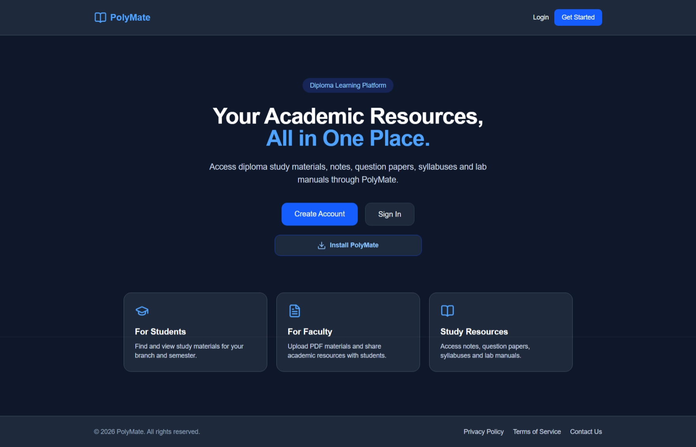
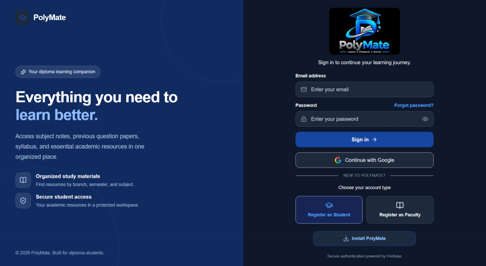
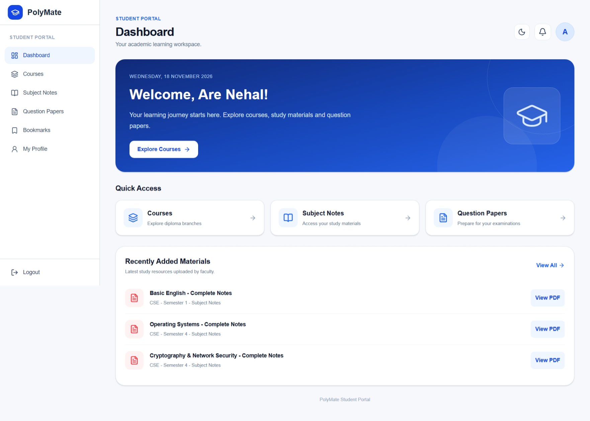
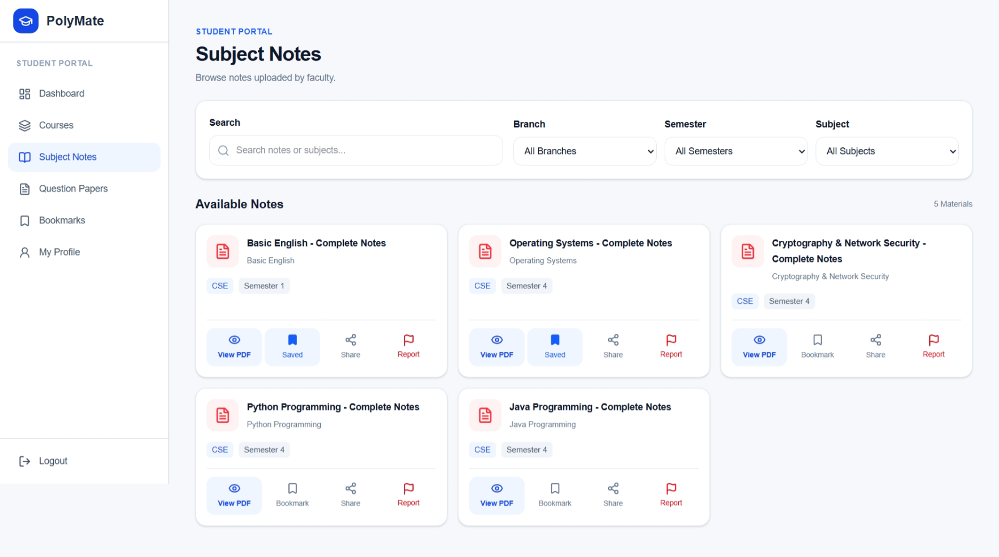
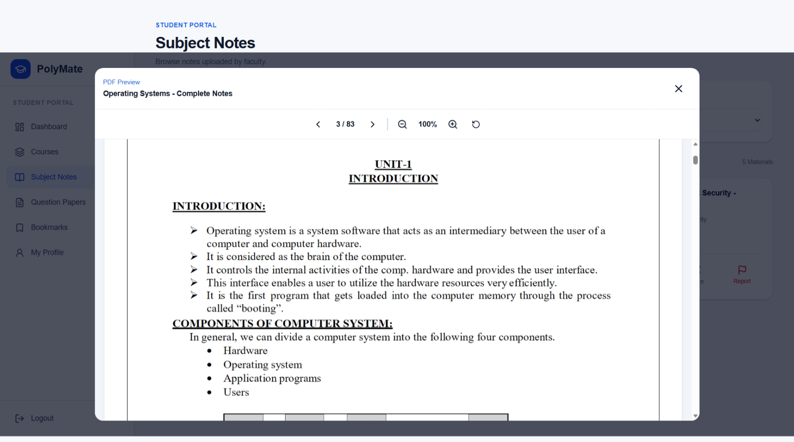
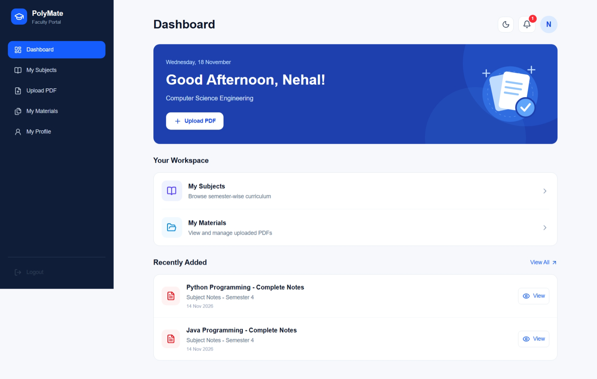
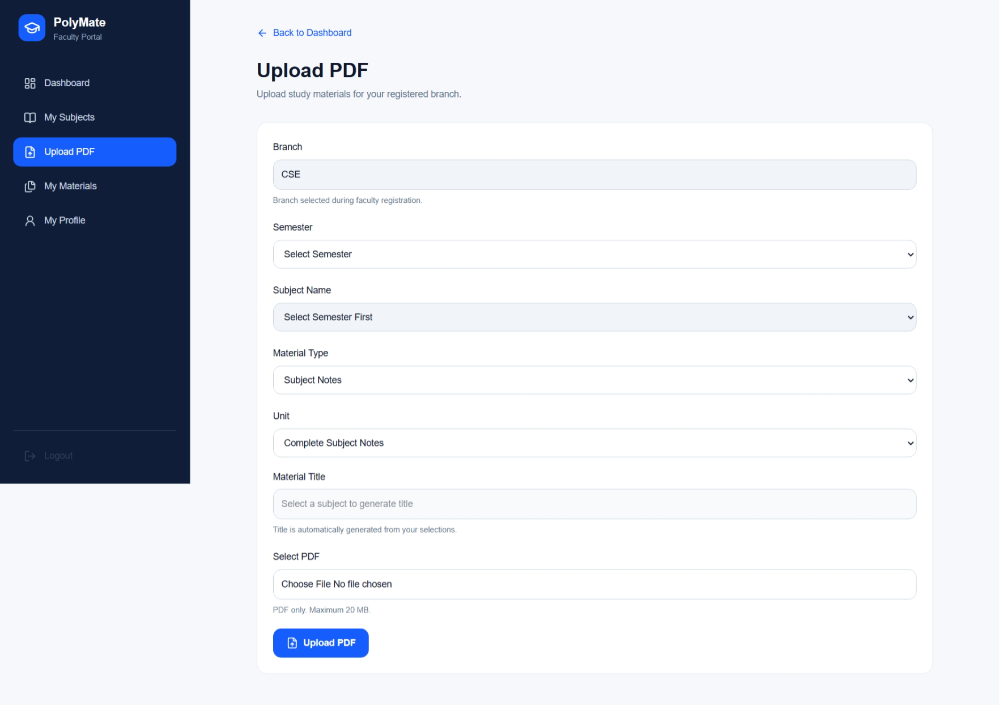
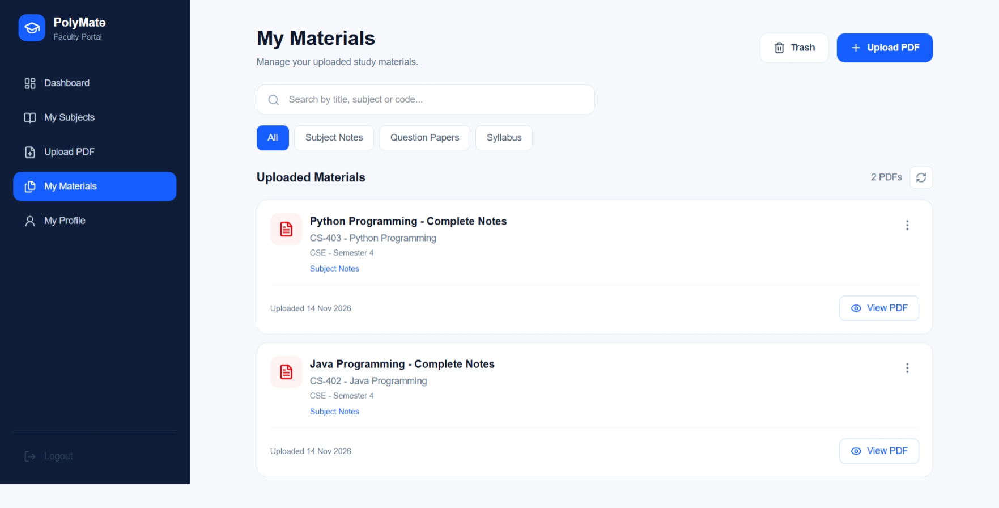
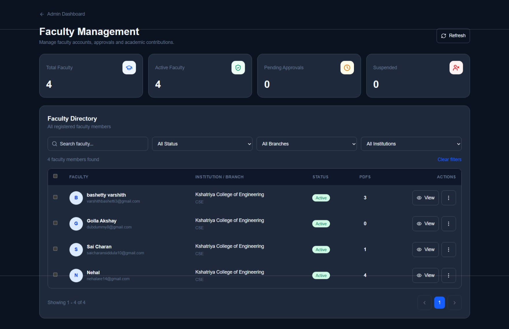

# PolyMate — Polytechnic Learning Platform


**[Live Website](https://polymate-frontend.vercel.app/)** |
**[GitHub Repository](https://github.com/arenihal/PolyMate)**

## Overview

PolyMate is an educational web application developed for Telangana diploma and polytechnic students and faculty.

It provides centralized access to notes, question papers, syllabuses, and laboratory manuals.

## Application Screenshots

### Landing Page


### Login Page


### Student Dashboard


### Student Subject Notes


### Secure PDF Preview


### Faculty Dashboard


### Faculty PDF Upload


### Faculty Materials Management


### Faculty Management Demonstration
This screenshot shows the faculty-management interface used for project demonstration; it is not presented as a live student/faculty role.


## Features

### Student Features

- Student registration and secure login
- Firebase Authentication and email verification
- Supported Google Sign-In
- Student dashboard
- Browse academic study materials
- Filter by branch, semester, subject, and material type
- Secure PDF preview
- Bookmark study materials
- Report issues with uploaded PDFs
- Student profile management

### Faculty Features

- Faculty registration and authentication
- Faculty dashboard
- Upload PDF study materials
- View and manage uploaded materials
- Edit material information
- Preview uploaded PDFs
- Receive and resolve student material reports
- Replace reported PDFs
- Move materials to Trash
- Restore or permanently delete trashed materials
- Faculty profile management

### Additional Features

- Telangana polytechnic institution directory
- Light and dark mode
- Responsive user interface
- Progressive Web App support
- REST API integration

## Technology Stack

| Component | Technology |
|---|---|
| Frontend | Next.js 16, React, TypeScript |
| Styling | Tailwind CSS |
| Icons | Lucide React |
| Backend | Python Flask |
| Production Server | Gunicorn |
| Database | Supabase PostgreSQL |
| Storage | Supabase Storage |
| Authentication | Firebase Authentication |
| Token Verification | Firebase Admin SDK |
| Frontend Hosting | Vercel |
| Backend Hosting | Render |
| Version Control | Git and GitHub |

## Project Structure

```text
PolyMate/
├── frontend/
├── backend/
├── database/
└── README.md
```

## Getting Started

### Requirements

- Node.js and npm
- Python
- Firebase configuration
- Supabase configuration

### Frontend Setup

```bash
cd frontend
npm install
npm run dev
```

### Backend Setup

```bash
cd backend
pip install -r requirements.txt
python app.py
```

Configure environment variables before running the application.

## Deployment

Frontend: https://polymate-frontend.vercel.app/

Backend: https://polymate-1.onrender.com/api/health

## Security

- Firebase Admin SDK verifies authentication tokens.
- Protected endpoints require authorization.
- PDF previews use authenticated backend routes.
- Never commit service-account credentials or private keys.

## Project Status

Under active development.

---

Developed as an educational software project.
